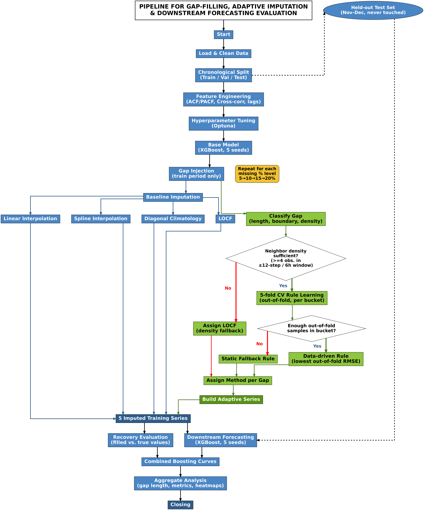

# Gap-Filling & Adaptive Imputation for Time-Series Air Temperature Forecasting

Comparison of gap-filling strategies for 30-minute air temperature data —
**Linear**, **Spline**, **Diagonal Climatology**, and **LOCF** baselines
against a proposed **Adaptive Imputation** method (cross-validated, rule-based
method selection per gap) — and how each affects a downstream XGBoost
forecasting model.

A full pipeline diagram is included at [`docs/pipeline_swimlane.png`](docs/pipeline_swimlane.png).

## Overview

Synthetic gaps are injected into the training period at several missing-data
percentages. Each method's **recovery accuracy** (filled vs. true value) is
evaluated against ground truth, and each method's **downstream accuracy** is
evaluated by training an XGBoost forecaster on the gap-filled data and testing
it on a genuinely held-out period.

Adaptive Imputation selects a fill method per gap based on the gap's length,
boundary shape, and local neighbor density. Its selection rules are learned
with **5-fold cross-validation** (out-of-fold only, with a static fallback
rule for buckets with too few samples) specifically to avoid validating an
imputation rule on the same data used to design it.

## Repository structure

```
.
├── proj_exp_final.py          # Main pipeline script — run this
├── xgboost_model.py           # Feature engineering, XGBoost training/eval, plotting
├── interpolation_methods.py   # The 4 baseline fill methods
├── Proj data.csv              # Input data
├── docs/
│   └── pipeline_swimlane.png  # Pipeline diagram (see below)
└── outputs/                   # Generated on run — plots, CSVs, comparison tables
```

## Pipeline



At a high level:

1. **Data prep** — load the station data, clean invalid readings, and split
   chronologically into train / validation / test. The test period
   (Nov–Dec 2017) is never touched by anything upstream of the final
   evaluation step.
2. **Feature engineering** — lag selection via ACF/PACF (air temperature) and
   cross-correlation (humidity, wind speed, wind direction), plus rolling
   statistics and cyclical time-of-day encodings.
3. **Base model** — an XGBoost model tuned with Optuna and trained on the
   clean (non-gappy) data, as a reference point.
4. **Missing-data experiment**, repeated at 5%, 10%, 15%, and 20% missing:
   - Synthetic gaps are injected into the **training period only**.
   - The 4 baseline methods each fill the gaps independently.
   - Adaptive Imputation classifies each gap and assigns a fill method using
     rules learned via 5-fold out-of-fold cross-validation (with a static
     fallback rule when a bucket has too few samples).
   - Each of the 5 resulting training sets is evaluated two ways: **recovery**
     (filled vs. true values) and **downstream forecasting** (XGBoost trained
     on each, evaluated on the same untouched test period, 5 random seeds).
5. **Aggregate analysis** — gap-length distributions, R²/RMSE comparison
   tables and heatmaps (each with a bar-chart companion), condition/boundary/
   length breakdowns, combined boosting curves, and summary plots.

## Requirements

```
pandas
numpy
scipy
scikit-learn
xgboost
optuna
statsmodels
matplotlib
```

Install with:
```bash
pip install pandas numpy scipy scikit-learn xgboost optuna statsmodels matplotlib
```

## Data

`Proj data.csv` is included in this repository. Columns:

| Column | Description |
|---|---|
| `TIMESTAMP` | 30-minute timestamps (`DD-MM-YYYY HH:MM`) |
| `AirTC_18m` | Air temperature (°C) |
| `RH_18m` | Relative humidity |
| `WS_ms_18m_Avg` | Wind speed (m/s) |
| `WindDir_18m` | Wind direction |

To use a different dataset, match these column names or update them (and the
`TEST_START` date) in `xgboost_model.py`.

## Running

```bash
python3 proj_exp_final.py
```

This runs the full pipeline end-to-end (hyperparameter tuning, base model, all
four missing-data scenarios, and the aggregate analysis). It will take a
while — multiple XGBoost fits per scenario across 5 random seeds, plus the
5-fold CV rule learning for adaptive imputation.

All outputs (plots, CSVs, comparison tables) are written to `outputs/`,
organized into subfolders by category (model results, recovery analysis,
adaptive imputation, comparison reports, etc.).

## Key methodology notes

- **No test-set leakage**: the held-out test period (Nov–Dec) is fixed before
  any gap injection or model tuning happens, and is never used to make design
  decisions.
- **No recovery-rule circularity**: the adaptive method's per-gap rules are
  learned using 5-fold cross-validation, so no gap's own true value is ever
  used (directly or indirectly) to pick its own fill method.
- **Multi-seed evaluation**: every reported downstream metric is averaged over
  5 random seeds (mean ± std), not a single run.
- **Publication-quality plots**: every figure the pipeline produces is
  enforced to ≥300 DPI with a tight, white-background crop.

## License

Add your license of choice here before publishing.
